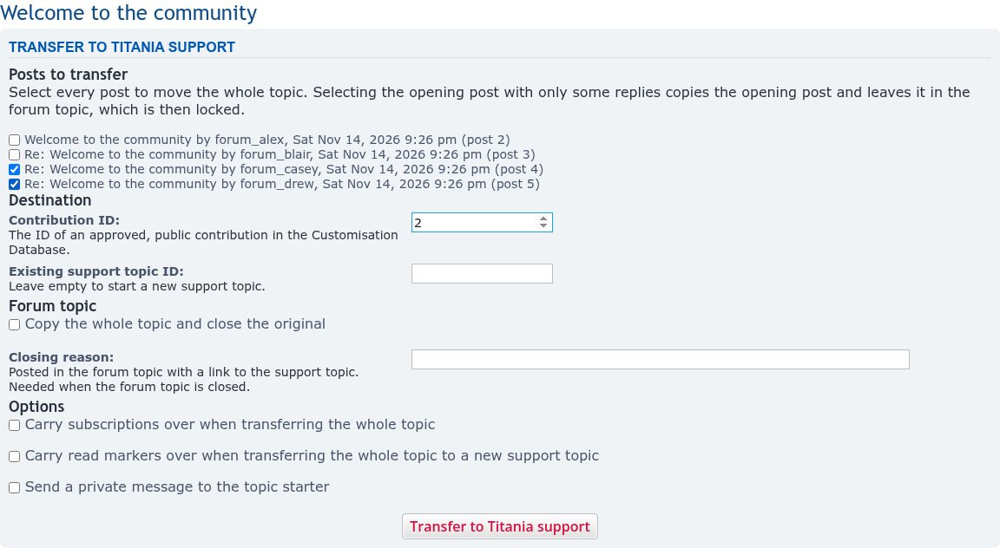
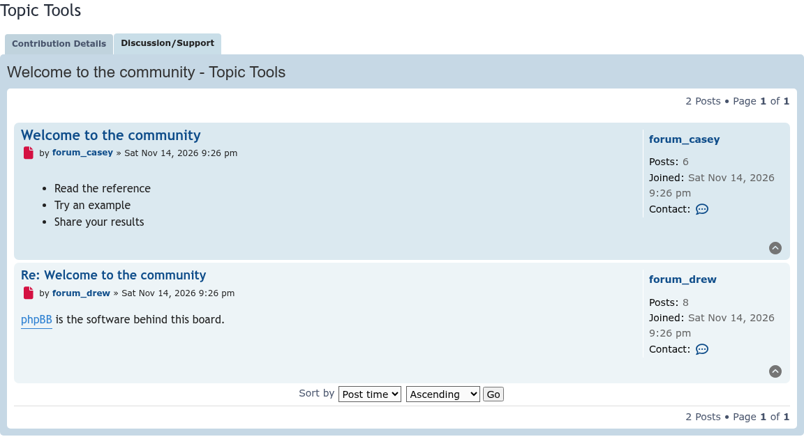
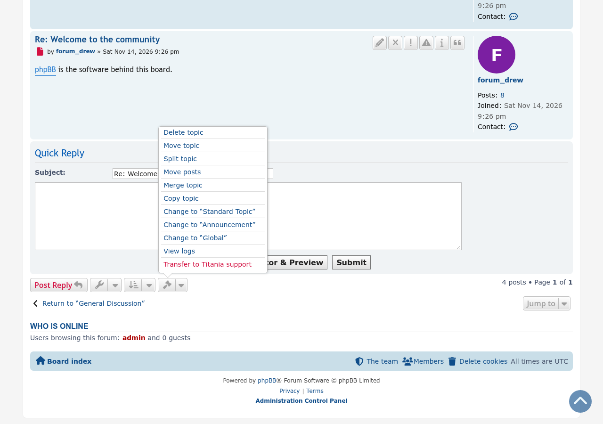
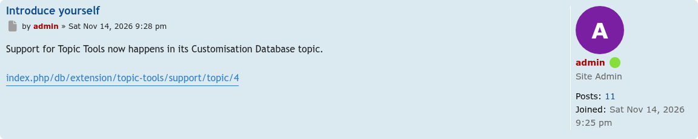

# Titania Topic Transfer

 

Lets moderators transfer forum topics and posts to Titania contribution support topics.

## Features

- **Transfer to Titania support** in a topic's **Quick-mod tools** opens a transfer page listing the topic's approved posts.
- Move selected replies to a **new support topic** or to an **existing one** of the same contribution. The replies are removed from the forum topic once Titania has them.
- **Move a whole topic**: every post goes to Titania, and the forum topic is kept as a locked topic with a link to the support topic.
- **Copy and close**: the whole topic is copied to Titania, and the forum topic stays as it was, locked, with a closing reply giving your reason and the link.
- Selecting the opening post with only some replies copies the opening post, moves the replies, and locks the forum topic with your reason and the link.
- Attachments go with their posts when Titania support accepts their file type.
- Optionally carry the topic's subscriptions and read markers over, and send the topic starter a private message with the link.
- Each transfer runs as one database transaction and is checked before the forum side changes; if any step fails, nothing changes. Every transfer goes into the **moderator log**.
- Only topics in forums guests can read, with approved posts, can go to public support.

## Screenshots

<table>
<tr>
<td></td>
<td></td>
</tr>
<tr>
<td></td>
<td></td>
</tr>
</table>

Click an image for the full size, or see [all screenshots with captions](docs/images/screenshots/README.md).

## Permissions

The option shows for moderators who have **Can move topics** in the forum and Titania's **Can moderate posts** permission. Removing posts also needs **Can delete posts**, and locking the forum topic needs **Can lock topics** and **Can reply to topics** in that forum.

## Requirements

- phpBB 4.0
- PHP 8.2 or later
- [Titania](https://github.com/phpbb/customisation-db) (the Customisation Database) from its `4.0.x` branch, installed on the same board. That branch does not yet run on phpBB 4.0 without fixes. Until they are merged into Titania, follow [Installing Titania on phpBB 4.0](https://github.com/phpbbmodders/titaniatopictransfer/wiki/Installing-Titania-on-phpBB-4.0) to use the branch with the fixes the extension was tested with.

## Installation

1. Copy the extension to `/ext/phpbbmodders/titaniatopictransfer`
2. In the Administration Control Panel, go to **Customise → Manage extensions**
3. Enable the **Titania Topic Transfer** extension

## Contributing

Contributions are welcome!

- **Bug reports**: [Open an issue](https://github.com/phpbbmodders/titaniatopictransfer/issues).
- **Everything else** (questions, feature requests, ideas, general discussion): [Use Discussions](https://github.com/orgs/phpbbmodders/discussions), or the [community forum](https://www.phpbbmodders.com/community/).
- Pull requests are welcome for bug fixes or discussed features.

## Acknowledgments

- The workflow follows the archived [phpBB Move Topic to Titania](https://github.com/Geolim4/phpBB-move-topic-to-Titania) MOD.
- Written with [Codex](https://openai.com/codex/); validation fixes, tests and documentation by [Claude](https://www.anthropic.com/claude).

## License

This extension is licensed under the **GNU General Public License v2.0**.

See [license.txt](license.txt) for more information.
