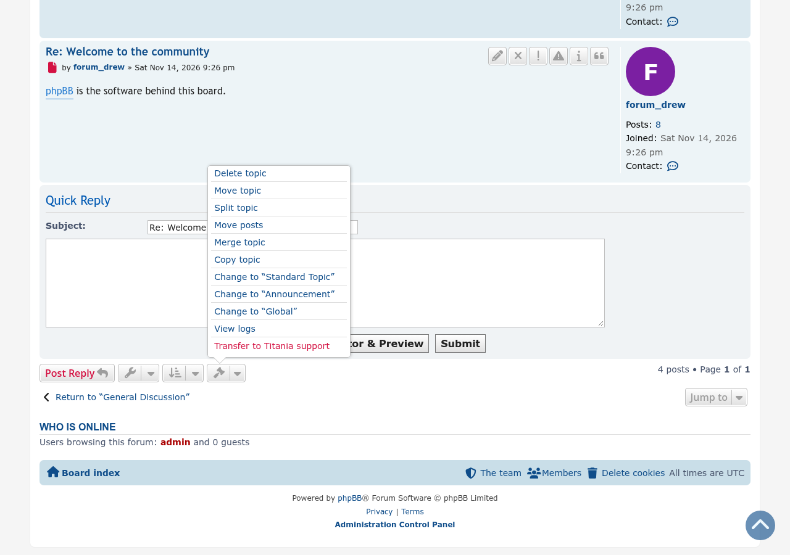
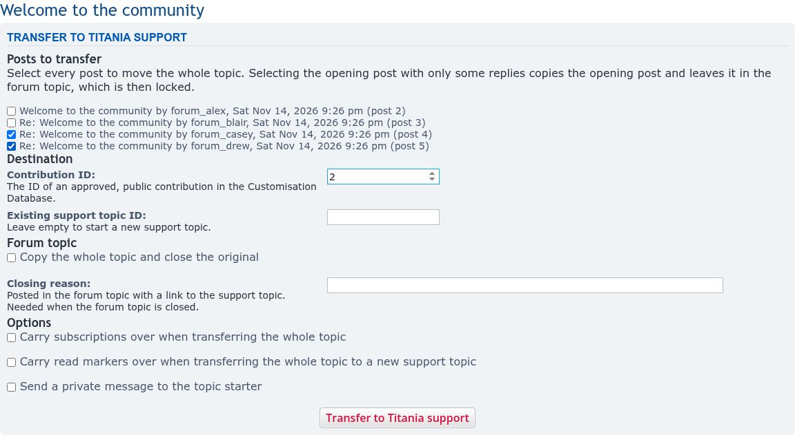
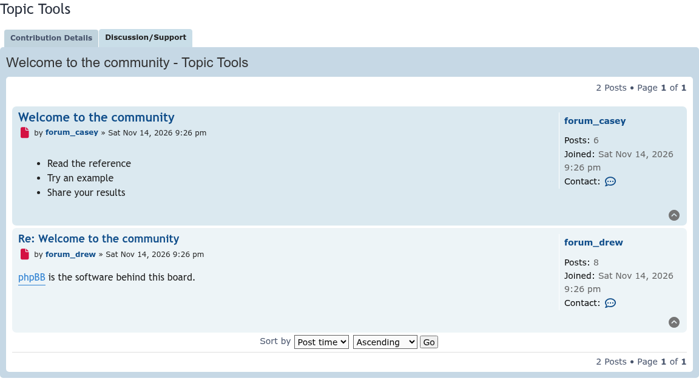
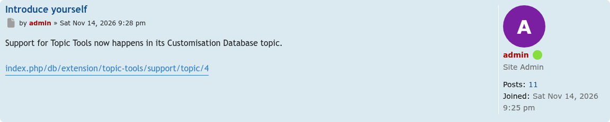

# Screenshots

Taken on a phpBB 4.0 test board with Titania, using the standard seed-forum test data. Click an image for the full size.

## Quick-mod tools

**Transfer to Titania support** is the last option in a topic's Quick-mod tools. It shows for moderators who can move the topic and moderate Titania posts.

## Transfer page

The topic's approved posts, the destination contribution and support topic, what happens to the forum topic, and the options. Here two replies are selected to go to a new support topic.

## In Titania

The two replies in a new support topic of the contribution, under the forum topic's title, by their original authors.

## Closed forum topic

After **Copy the whole topic and close the original**, the forum topic is locked and gets a closing reply with the moderator's reason and a link to the support topic.

